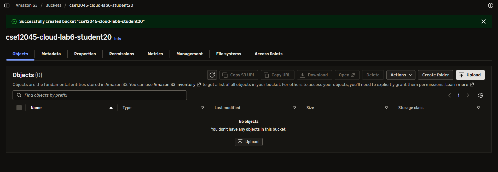
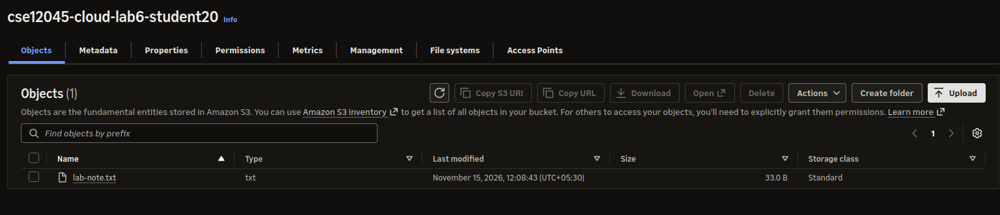
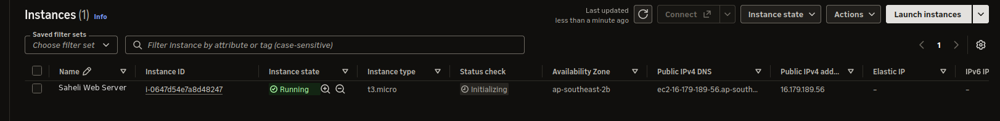
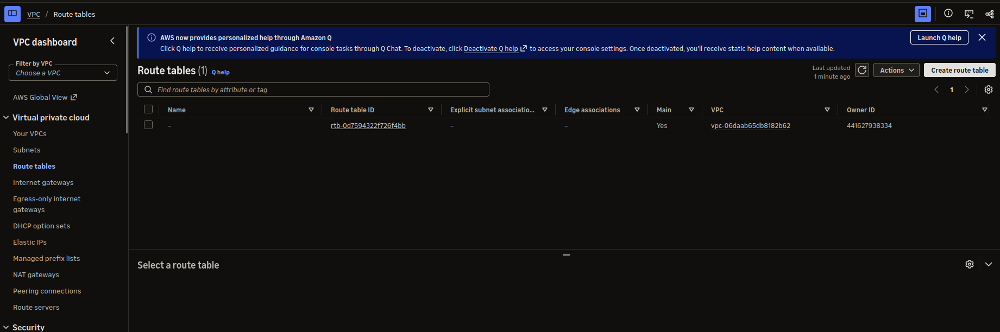
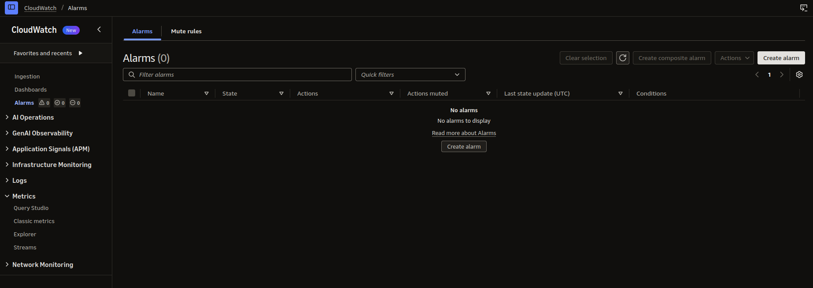
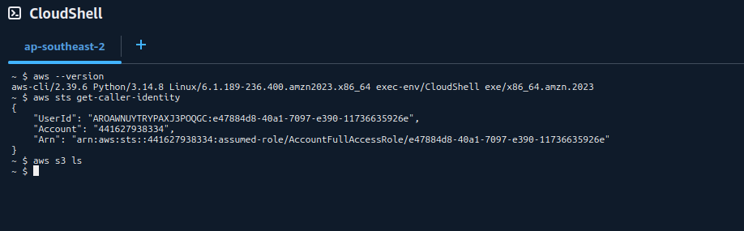
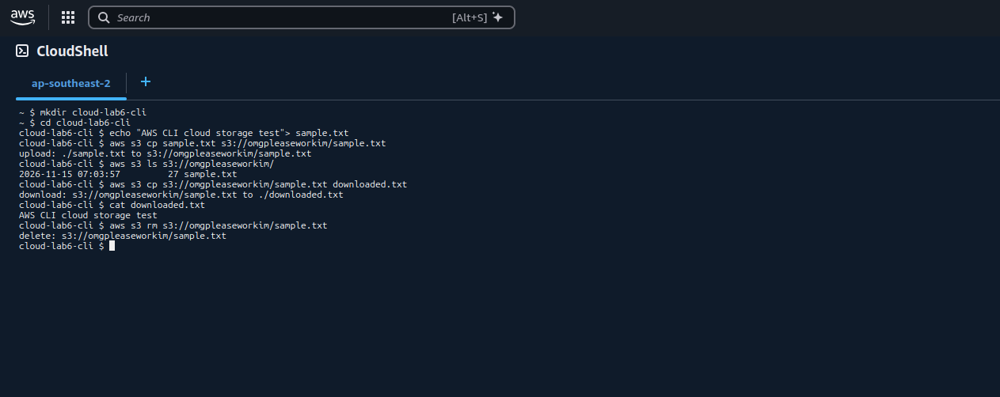
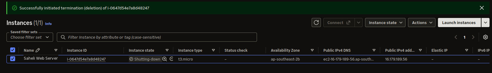

# Lab 6: Familiarization and Usage of Cloud Services Using AWS and Open-Source Cloud Tools  

**Aim:** To become familiar with different cloud services and perform basic cloud operations using Amazon Web Services (AWS), Ubuntu Linux, Oracle VirtualBox, and the AWS Command Line Interface (CLI).

---

## Overview of Practical Tasks

| Task | What needs to be done? | How to demonstrate? |
| :--- | :--- | :--- |
| **1. Virtual Machine Setup** | Install Ubuntu using VirtualBox and execute basic Linux commands. | A working Ubuntu virtual machine and terminal output. |
| **2. Cloud Storage (S3)** | Create an Amazon S3 bucket, upload a file, view it, and download it. | Successful file upload and download in AWS S3. |
| **3. Cloud Service Exploration** | Explore IAM, EC2, and VPC through the AWS Console. | Understanding of cloud security, virtual machines, and networking. |
| **4. Cloud Monitoring & CLI** | Explore CloudWatch and execute basic AWS CLI commands. | Service metrics and successful command outputs. |

---

## Task 1: Virtual Machine (VM) Setup

### Step 1 & 2: Create VM & Install Ubuntu
1. Ensure Oracle VirtualBox is installed and your Ubuntu Linux Virtual Machine is created and running.
2. Log in to your Ubuntu desktop environment and open the **Ubuntu Terminal**.

### Step 3 & 4: Update Ubuntu & Install Basic Utilities
Run the following commands inside your **Ubuntu Terminal**:

```bash
sudo apt update
sudo apt install -y curl wget unzip tree
```

---

## Task 2A: Introduction to AWS Management Console
1. Navigate to <https://aws.amazon.com/console/> in your web browser.
2. Sign in using your **Root user** or **IAM user** credentials.
3. Observe the key dashboard regions:
   * **AWS Services Search Bar:** Quick navigation to any AWS service.
   * **Region Selector:** (e.g., `us-east-1`, `ap-south-1`).
   * **Account Menu:** User profile, Account ID, and Billing dashboard.

---

## Task 2B: Implementation of Cloud Storage Using Amazon S3

### Step 1: Open Amazon S3
1. Type **S3** into the search bar and select **S3 (Scalable Storage in the Cloud)**.

### Step 2: Create an S3 Bucket
1. Click **Create bucket**.
2. **Bucket name:** Enter a globally unique bucket name (e.g., `omgpleaseworkim`).
3. **AWS Region:** Keep the default recommended region (e.g., `ap-south-1` or `us-east-1`).
4. **Block Public Access settings for this bucket:** Leave **Block all public access** checked (best practice for security).
5. Leave all other settings at default and click **Create bucket**.


*Figure 6.1: S3 bucket successfully created in AWS Management Console.*

### Step 3: Create a Sample File in Ubuntu
Inside your Ubuntu terminal:
```bash
echo "Hello from Ubuntu Virtual Machine - Cloud Computing Lab" > lab-note.txt
cat lab-note.txt
```

### Step 4: Upload the File to S3 (via Browser GUI)
1. In the S3 Console, click on your newly created bucket name.
2. Click **Upload** -> **Add files**.
3. Select `lab-note.txt` from your local machine and click **Upload**.


*Figure 6.2: Successfully uploaded file to Amazon S3 bucket.*

### Step 5: Download the File
1. In the bucket object list, click `lab-note.txt`.
2. Click **Download** to save the object locally, verifying storage integrity.

### Step 6: Delete the Test Object
1. Select `lab-note.txt` in your S3 bucket, click **Delete**, type `permanently delete` in the confirmation box, and click **Delete objects**.

---

## Task 3A: Identity and Access Management Using AWS IAM

### Step 1: Open IAM
1. Search for **IAM** in the AWS Console search bar and open the **IAM Dashboard**.
2. Observe **Users**, **User groups**, **Roles**, and **Policies**.

### Step 2 & 3: Understand IAM Policies & Least Privilege
Review this illustrative IAM Policy structure adhering to the **Principle of Least Privilege**:

```json
{
  "Version": "2012-10-17",
  "Statement": [
    {
      "Effect": "Allow",
      "Action": [
        "s3:ListBucket"
      ],
      "Resource": "arn:aws:s3:::example-bucket"
    }
  ]
}
```

---

## Task 3B: Virtual Machine Provisioning Using Amazon EC2

### Step 1 & 2: Open EC2 & Explore Instance Launch
1. Search for **EC2** in the AWS Console and open the **EC2 Dashboard**.
2. Navigate to **Instances** -> **Launch instances**.
3. Observe configuration options: AMI (Ubuntu Server), Instance Type (`t2.micro` Free Tier eligible), Key pair, Network Settings (VPC & Security Groups), and Storage (EBS).


*Figure 6.3: Provisioned Amazon EC2 virtual machine instance running in AWS.*

---

## Task 4A: Virtual Networking Using Amazon VPC

### Step 1 & 2: Open Amazon VPC & Explore Components
1. Search for **VPC** in the AWS Console and open the **VPC Dashboard**.
2. Observe core networking components:
   * **Your VPCs:** Default VPC IPv4 CIDR blocks.
   * **Subnets:** Availability zone subnet distribution.
   * **Route tables:** Route associations and internet gateway routing.
   * **Internet gateways:** External internet connectivity.
   * **Security groups:** Inbound and Outbound firewall rules.


*Figure 6.4: Virtual Private Cloud (VPC) dashboard and network resource topology.*

---

## Task 3D: Cloud Monitoring Using Amazon CloudWatch

### Step 1, 2 & 3: Explore Metrics and Alarms
1. Search for **CloudWatch** in the AWS Console.
2. In the left menu, explore **Metrics** -> **All metrics** to inspect per-service CPU, Network, and Disk utilization.
3. Explore **Alarms** -> **All alarms** to examine alarm thresholds (e.g., `CPUUtilization > 80%`).


*Figure 6.5: Amazon CloudWatch metrics monitoring dashboard.*

---

## Task 4B: Basic AWS Operations Using AWS CLI

### Step 1: Open AWS CloudShell
1. Click the **CloudShell icon** (`>_`) in the top navigation bar of the AWS Console.
2. Wait for the shell environment to initialize.

### Step 2 & 3: Verify AWS CLI Installation & Account Identity
```bash
aws --version
aws sts get-caller-identity
```


*Figure 6.6: Initializing AWS CloudShell and verifying caller identity.*

### Step 4: List Available S3 Buckets
```bash
aws s3 ls
```

### Step 5: Create a Local File Inside CloudShell
```bash
mkdir -p ~/cloud-lab6-cli
cd ~/cloud-lab6-cli
echo "AWS CLI Cloud Storage Test" > sample.txt
ls -l
```

### Step 6: Upload the File to S3 via CLI
```bash
aws s3 cp sample.txt s3://omgpleaseworkim/sample.txt
```

### Step 7: List Objects in the Bucket
```bash
aws s3 ls s3://omgpleaseworkim/
```

### Step 8 & 9: Download and Verify File from S3
```bash
aws s3 cp s3://omgpleaseworkim/sample.txt downloaded.txt
cat downloaded.txt
```


*Figure 6.7: Executing S3 upload, list, download, and verification commands in CloudShell.*

### Step 10: Delete Object & Clean Up Bucket
```bash
aws s3 rm s3://omgpleaseworkim/sample.txt
aws s3 rb s3://omgpleaseworkim
```

---

## Final Lab Cleanup & Resource Termination
To ensure zero ongoing charges:
1. Verify test S3 bucket is empty and removed (`aws s3 ls`).
2. Terminate the launched EC2 instance and ensure storage volumes are detached/deleted.


*Figure 6.8: Terminating EC2 compute instance after completing verification.*
